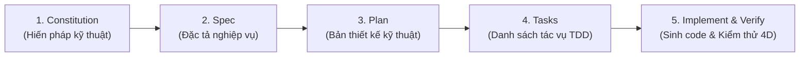

# SPECIFICATION-DRIVEN DEVELOPMENT (SPEC-KIT) SKILL

> [!IMPORTANT]
> **Code serves specifications, not the other way around.**
> Không bao giờ "vibe code" hoặc nhảy thẳng vào viết code khi chưa có Đặc tả (Spec), Kế hoạch kỹ thuật (Plan) và Danh sách tác vụ (Tasks) được phê duyệt. Mọi dòng code sinh ra phải là sự cụ thể hoá trực tiếp từ các tài liệu này.

---

## 1. TRIẾT LÝ CỐT LÕI (THE POWER INVERSION)
- **Specifications as the Primary Source of Truth**: Đặc tả yêu cầu kỹ thuật là tài sản trung tâm. Mã nguồn (Code) chỉ là bản thể hiện kỹ thuật của đặc tả trong một ngôn ngữ/framework cụ thể.
- **Executable Specifications**: Đặc tả phải chính xác, đầy đủ, không mơ hồ (unambiguous), có ma trận kiểm thử và tiêu chuẩn nghiệm thu rõ ràng để có thể sinh ra và xác thực mã nguồn.
- **Continuous Refinement**: Việc rà soát tính nhất quán (Consistency Checking) giữa Spec ↔ Plan ↔ Tasks ↔ Code diễn ra liên tục ở mọi bước.
- **Debugging & Refactoring**: Khi xảy ra lỗi (bug), trước hết phải sửa ở Đặc tả và Kế hoạch thực thi, sau đó mới tái sinh và điều chỉnh code.

---

## 2. QUY TRÌNH SDD CHUẨN 5 BƯỚC (WORKFLOW)



### Bước 1: The Constitution (`.specify/memory/constitution.md`)
- Thiết lập luật bất biến của dự án (Non-negotiables, Architectural Invariants, Quality Gates).
- Mọi bản kế hoạch (`plan.md`) trước khi thực hiện bắt buộc phải qua bước **Constitution Check** (Cổng kiểm soát hiến pháp). Nếu vi phạm bất kỳ điều khoản nào (ví dụ: thiếu unit test, sai DDD, vi phạm bảo mật), kế hoạch phải được điều chỉnh lại ngay.

### Bước 2: The Spec (`specs/[feature]/spec.md`)
- Mô tả chi tiết tính năng từ góc nhìn giá trị người dùng (User Journeys) có phân cấp ưu tiên:
  - **P1 (MVP Core)**: Luồng nghiệp vụ thiết yếu nhất.
  - **P2 (Important)**: Tính năng mở rộng giá trị cao.
  - **P3 / P4**: Các tiện ích nâng cao hoặc tối ưu hoá.
- Bắt buộc có **Acceptance Scenarios** theo chuẩn **Given - When - Then** và danh sách **Edge Cases**.

### Bước 3: The Plan (`specs/[feature]/plan.md`)
- Bản thiết kế kỹ thuật (Technical Blueprint):
  - Kiến trúc phân tầng (Clean Architecture / DDD).
  - Lựa chọn công nghệ & Thư viện (kèm lý do lựa chọn).
  - Data Model (`data-model.md`): Bảng CSDL, Value Objects, Aggregate Roots.
  - Hợp đồng API (`contracts/`): Input/Output Schema, Status Codes, Error Responses.
  - Hướng dẫn kiểm chứng nhanh (`quickstart.md`).

### Bước 4: The Tasks (`specs/[feature]/tasks.md`)
- Chia nhỏ Plan thành danh sách tác vụ khả thi theo chuẩn:
  - `[ID] [P?] [Story] Mô tả chi tiết kèm đường dẫn file`
  - `[P]`: Đánh dấu tác vụ có thể chạy song song (Parallelizable - độc lập file).
  - Phân theo các Phase rõ ràng:
    - **Phase 1: Setup** (Khởi tạo thư viện, cấu hình linting, test runner).
    - **Phase 2: Foundational** (Database schema, Migration, Core interfaces, Error handling).
    - **Phase 3: User Story 1 (P1 - MVP)** (Triển khai test trước $\rightarrow$ Code sau).
    - **Phase 4: User Story 2 (P2)**, v.v.
    - **Phase N: Polish & Verification** (Tích hợp, Audit bảo mật, Performance).

### Bước 5: Implementation & Verification (TDD Mandate)
- Thực thi từng task theo thứ tự phụ thuộc.
- Áp dụng triệt để quy tắc **TDD 4 chiều (Input / Output / Error / Logic Invariants)** kết hợp với `code-convention` và `fe-development`.
- Không bàn giao task khi chưa chạy test thành công (`green`).

---

## 3. CẤU TRÚC THƯ MỤC CHUẨN TRONG REPOSITORY
```text
.specify/
├── memory/
│   └── constitution.md        # Hiến pháp kỹ thuật dự án
└── templates/
    ├── constitution-template.md
    ├── spec-template.md
    ├── plan-template.md
    ├── tasks-template.md
    └── checklist-template.md

specs/
└── [###-feature-name]/
    ├── spec.md                # Đặc tả yêu cầu & User Stories
    ├── plan.md                # Kế hoạch kiến trúc kỹ thuật
    ├── data-model.md          # Thực thể DDD & Schema CSDL
    ├── contracts/             # API Schemas & DTO Contracts
    ├── quickstart.md          # Kịch bản kiểm chứng nhanh
    └── tasks.md               # Danh sách tác vụ thực thi TDD
```

